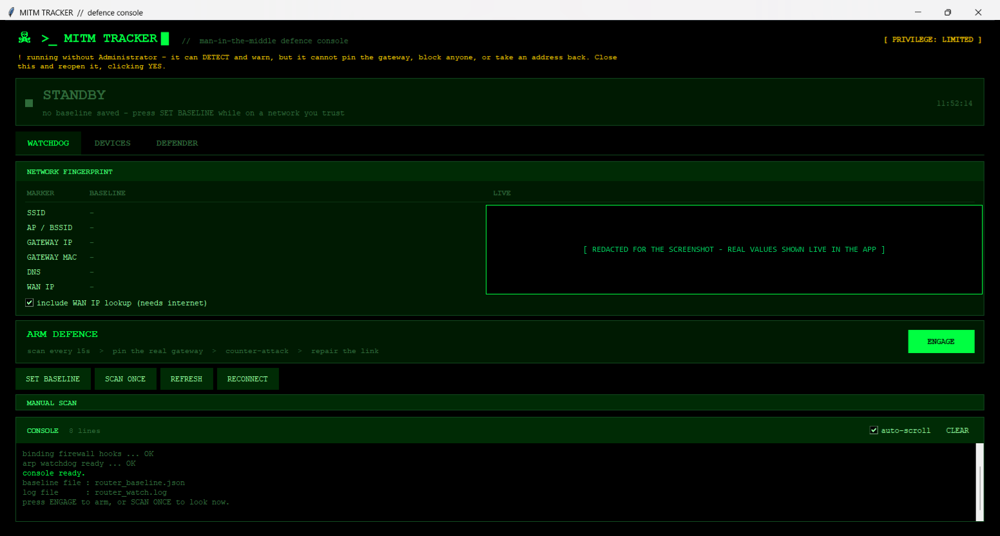
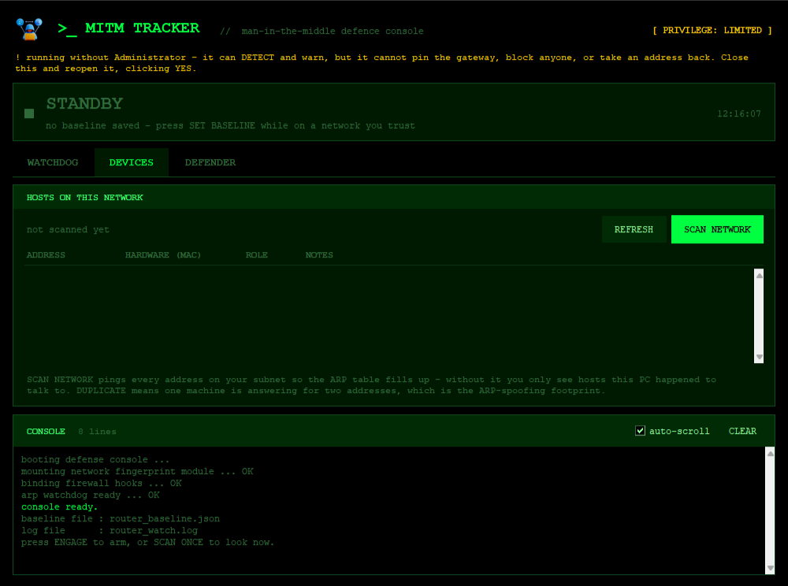
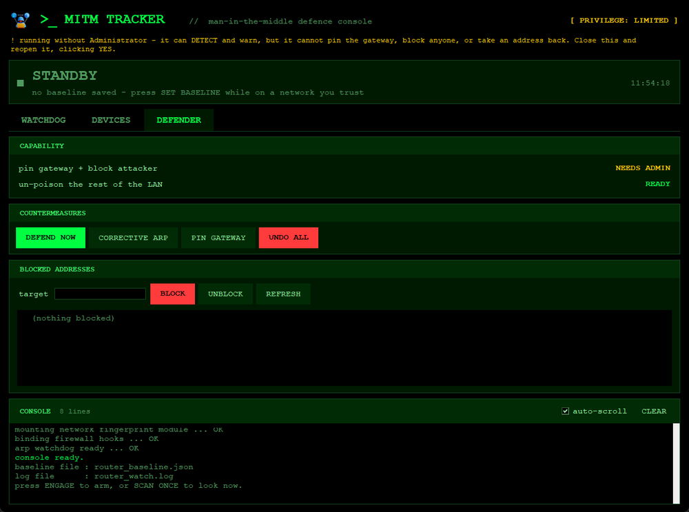

# MITM Tracker

Detect and undo man-in-the-middle attacks on your network — a Windows defence console with a phosphor-green terminal UI.

[](https://github.com/jaylalkiya/MITM--Tracker/releases/latest)



## What it does

It fingerprints the network you trust (SSID, access point, gateway IP/MAC, DNS, subnet, public IP), then keeps comparing the live network against that baseline. Three different attacks produce three different symptoms — and telling them apart is the whole point:

| Symptom | Meaning | Response |
|---|---|---|
| Router MAC changed, IP did not | ARP spoofing, or a rogue router | Re-teach the LAN the real MAC, pin the gateway, block the attacker |
| Gateway IP / subnet / DHCP changed, Wi-Fi did not | Something is answering DHCP in your router's place | Renew the lease, and take the address back statically if the rogue server keeps winning |
| Wi-Fi / access point / adapter changed | You're not on the trusted network any more | Reconnect to the one you were on |

Everything it changes (ARP pins, firewall blocks, a forced static address) can be undone with one command: `--clear`.

## ATT&CK coverage

| Technique | What it is | How it shows up here |
|---|---|---|
| [T1557.002](https://attack.mitre.org/techniques/T1557/002/) | ARP Cache Poisoning | Gateway MAC changes while its IP stays the same; one MAC answering for several addresses |
| [T1557.003](https://attack.mitre.org/techniques/T1557/003/) | DHCP Spoofing | Gateway, subnet or DHCP server changes while the Wi-Fi and access point do not |
| [T1557.004](https://attack.mitre.org/techniques/T1557/004/) | Evil Twin | Same SSID served by a different access point (BSSID) |

## Requirements

- Windows 10 or 11. Linux gets best-effort detection and Wi-Fi reconnection only; the countermeasures are Windows-only.
- Detection reads English `netsh` output. On a localised Windows the labels differ, and the affected markers show as unknown rather than guessing wrong.

## Quick start

[Download the latest `MITM-Tracker.exe`](https://github.com/jaylalkiya/MITM--Tracker/releases/latest) — no installer, no Python needed. Then:

```
MITM-Tracker.exe                 # opens the console
MITM-Tracker.exe --init          # once: trust the current network
MITM-Tracker.exe --protect       # full protection until Ctrl+C
```

Needs Administrator to pin the gateway, block an attacker, or take an address back — detection alone works without it.

The `.exe` is unsigned, so Smart App Control or SmartScreen may refuse to run it; running from source avoids that.

Running from source instead: `python mitm_tracker.py` (needs Python 3; `pip install scapy` + [Npcap](https://npcap.com) to un-poison other hosts on the LAN, not just this one).

## Reading the console

- **STANDBY** — not scanning · **ARMED** — scanning and set to fight back · **SECURE** — scanned, nothing changed · **INTRUSION** — something changed · **NO BASELINE** — run `--init` first · **LINK DOWN** — no network right now
- **NETWORK FINGERPRINT** — baseline vs. live, one row per marker; `[ !! ]` means that row changed
- Three tabs: **WATCHDOG** (fingerprint + arm/scan), **DEVICES** (everyone on your network), **DEFENDER** (countermeasures + block list)

| WATCHDOG | DEVICES | DEFENDER |
|---|---|---|
|  |  |  |

Full command reference, troubleshooting, and the phone-notification setup are in [`README.txt`](README.txt).

## Main commands

```
--init              record this network as trusted
--protect            full protection until Ctrl+C
--status             trusted vs. now, plus what's available
--watch 60            keep checking every 60s, warn only
--defend / --restore / --harden / --strict      individual responses
--devices             every host on your network
--networks            access points in range
--block IP / --unblock IP
--clear               undo every change this tool made
--test-notify          check that alerts reach you
--help                 everything, grouped
```

`--help` lists the rest, including `--dhcp` (hand a forced static address back to DHCP), `--pin`, `--force` and `--compare`.

## Tests

```
python -m unittest
```

29 tests cover the detection and response logic. Every network read and system change is faked, so they need no Administrator rights, send no packets and never touch the real baseline, ARP table or firewall.

## Privacy

MITM Tracker has no telemetry. Your baseline and log stay in local files next to the program. It only makes these outbound web requests:

- **Public IP lookup:** asks `checkip.amazonaws.com`, `api.ipify.org` or `ifconfig.me`, so those services see your IP. Untick "include WAN IP lookup" in the console to turn this off.
- **Webhook alerts (off by default):** if you set up a webhook, each alert sends its title, message, your computer name and the time to that URL. Use a private channel, and a hard-to-guess topic name on `ntfy`.

`router_baseline.json` and `router_watch.log` contain your network's real identity (SSID, MAC addresses, public IP), so don't share them or include them in screenshots.

## Safety

Only use this on a network you own or are authorised to defend. It sends ARP packets, ping-sweeps the subnet, and edits the Windows Firewall — the same behaviours an attack tool would have, which is also why antivirus tools sometimes flag the packaged `.exe`. Run `python mitm_tracker.py` instead if you'd rather avoid that.

## License

[MIT](LICENSE)
